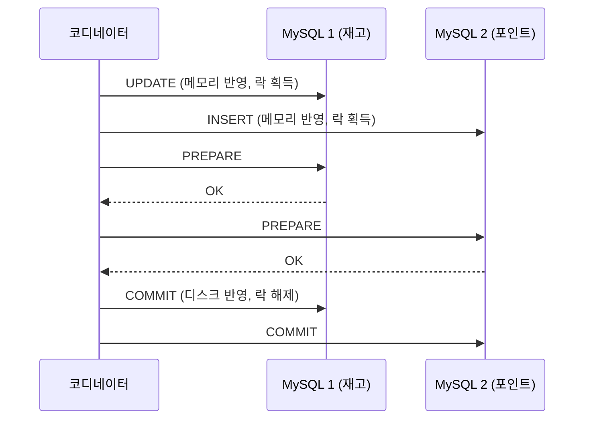

## 한 줄 정의

🟡 커밋을 Prepare / Commit 두 단계로 쪼개서, **"되돌릴 수 없는 지점"을 전원이 확인한 뒤로 미루는** 프로토콜.

## 왜 필요한가

참여자에게 바로 커밋을 시키면, 두 번째 참여자가 실패했을 때 **이미 커밋한 첫 번째를 되돌릴 방법이 없다.** 먼저 전원의 성공 가능성을 확인해 두고 실제 반영을 몰아서 하면 "일부만 커밋되는" 창이 최소가 된다.

Prepare 응답은 **"이제 나는 커밋에 실패하지 않는다"는 약속**이다.

## 어떻게 동작하는가



🔴 이 약속에는 대가가 있다. **Prepare 이후 참여자는 스스로 롤백해서는 안 된다.** 코디네이터의 명령을 기다려야 한다. 즉 참여자는 코디네이터가 다시 말을 걸어 줄 때까지 **락을 쥔 채로 묶여 있다.**

## 코드에 닿는 지점

🟡 **2PC는 애플리케이션 코드로 만나지 않는다. 대신 증상으로 만난다** — 원인 모를 락 대기, 그리고 `XA RECOVER`에 잡히는 커밋되지 않은 트랜잭션.

MySQL의 XA로 락의 수명을 눈으로 볼 수 있다.

```sql
-- 터미널 1
XA START 'product1';
UPDATE product SET quantity = quantity - 1 WHERE id = 1;
XA END 'product1';

-- 터미널 2 : 같은 로우를 건드리는 평범한 UPDATE
UPDATE product SET quantity = 50 WHERE id = 1;   -- ← 여기서 멈춘다

-- 터미널 1
XA PREPARE 'product1';
XA COMMIT 'product1';                            -- ← 이 순간 터미널 2가 풀린다
```

🟢 터미널 2는 `XA END` 뒤에도 계속 대기한다. 락은 `XA COMMIT`이 실행되어야 풀린다. **락의 수명이 코디네이터의 진행 속도에 묶여 있다**는 것이 실습의 전부다.

일상적으로 쓰는 `DataSourceTransactionManager`는 커넥션 하나만 다루므로 XA에 관여할 수 없다. 두 DataSource를 묶으려면 별도 JTA 트랜잭션 매니저와 XA DataSource가 필요하다.

## 트레이드오프

| 얻는 것 | 내주는 것 |
|---|---|
| 시스템 수준 원자성 — 보상 로직 불필요 | **가용성** — 참여자 하나가 멈추면 전부 멈춘다 |
| XA 지원 DB만 있으면 구현이 단순 | 호환성 — NoSQL·MQ 일부는 XA 미지원 |
| | **수동 복구** — 중간 상태는 자동 복구되지 않는다 |

🟡 2PC는 원자성을 확실히 얻는 대신 **가용성을 내준다.**

🔴 흔한 오해: 무서운 건 "Prepare에서 실패하는 것"이 아니다. **Prepare 실패는 전원 롤백으로 깔끔하게 끝난다.** 진짜 문제는 **Prepare까지 다 성공하고 Commit에서 깨지는 경우**다. 이때는 되돌릴 수도, 그냥 둘 수도 없어서 사람이 들어가야 한다.

💬 면접에서 "느려서 안 씁니다"로 끝내면 얕다. 느린 건 결과이고 원인은 **블로킹**이다.

## 실험으로 확인한 것

🟢 [[2PC 실험]]에서 MySQL XA로 직접 재현했다.

- **in-doubt가 실제로 매달린다** — prepare 직후 코디네이터가 죽고 커넥션이 끊겨도 prepared 트랜잭션은 살아 있다. **문제는 매달려 있다는 사실 자체를 아무도 모른다는 것.**
- `XA RECOVER`가 유일한 발견 수단 — 커넥션과 무관하게 서버에 남은 미결 트랜잭션을 찾아준다
- **그동안 다른 요청은 `ERROR 1205 Lock wait timeout exceeded`** 로 막힌다. 같은 행 SELECT는 커밋 전 옛 값을 본다
- JTA(Narayana·Atomikos)를 쓰면 `@Transactional` 한 줄로 끝나지만 🔴 **편해지는 건 코드지 성질이 아니다. 블로킹은 그대로 남는다**

## 연결

- [[2PC 실험]] — 위 내용을 직접 돌려본 것
- [[분산 트랜잭션이 필요한 순간]] — 이 문제가 왜 생겼는지
- [[TCC]] — 2PC의 Prepare/Commit을 **비즈니스 API로 다시 만든 것**
- [[Saga 패턴]] — 예약조차 없이 즉시 실행하고 되돌리는 반대편
- [[분산 트랜잭션 네 가지 비교]]
- 실험: [[2PC 실험]] — MySQL XA로 블로킹과 in-doubt를 직접 재현
- 면접: [[2PC의 문제는 무엇인가]]
