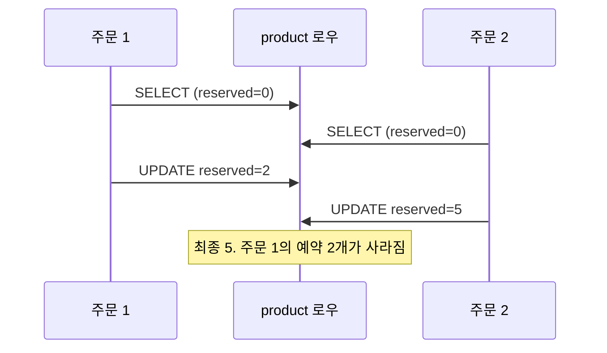

## 한 줄 정의

🟡 읽고-계산하고-쓰는 사이에 다른 트랜잭션이 끼어들어 **먼저 쓴 갱신이 덮이는** 것.

## 왜 필요한가

이 문제를 모르면 "락을 걸었는데 왜 값이 안 맞지?"에서 막힌다. 대개 **락의 단위가 문제와 어긋나 있다.**

주문 단위로 [[Redis 분산락]]을 걸어 뒀어도 키가 `orderId`라면, **서로 다른 주문이 같은 상품을 살 때는 아무것도 막히지 않는다.**

## 어떻게 동작하는가



🟢 예약 수량은 **7**이 되어야 하는데 **5**가 된다. 주문 2가 읽은 값(0)이 이미 낡았는데도 그 위에서 계산했기 때문이다.

## 코드에 닿는 지점

문제를 만드는 코드는 지극히 평범하게 생겼다.

```java
Product product = productRepository.findById(id).orElseThrow();  // 읽고
product.reserve(quantity);                                        // 계산하고
// 트랜잭션 커밋 시 UPDATE                                          // 쓴다
```

세 줄 사이에 다른 트랜잭션이 들어올 수 있다는 것이 전부다.

## 트레이드오프

푸는 길이 셋이다. 이건 트레이드오프라기보다 **선택 기준**이다.

| 방법 | 언제 |
|---|---|
| [[낙관적 락]] (`@Version`) | 충돌이 드묾. 재시도 로직을 붙일 수 있음 |
| [[비관적 락]] (`FOR UPDATE`) | 충돌이 잦음. 대기·데드락을 감수 |
| [[원자적 UPDATE로 푸는 동시성]] | 읽은 값이 계산에 필요 없을 때 (`SET x = x - 1`) |

🔴 **읽기 자체는 다른 트랜잭션의 읽기를 막지 않는다.** `SELECT`를 아무리 정교하게 짜도 이 틈은 안 없어진다. 쓰기 시점에 조건을 거는 것(버전 비교 또는 원자적 UPDATE)이 유일한 해법이다.

🔴 [[Saga 패턴]]에서 이력 테이블로 [[멱등성]]을 확보해도 Lost Update는 **그대로 남는다.** 이력 테이블은 "같은 요청이 두 번"을 막을 뿐, "다른 요청이 같은 로우를"은 못 막는다. 층이 다르다.

## 연결

- [[낙관적 락]] — 감지해서 재시도
- [[비관적 락]] — 아예 차단
- [[원자적 UPDATE로 푸는 동시성]] — 읽지 않고 쓰기
- [[조건부 상태 전이 선점]] — 같은 아이디어를 상태 전이에 적용한 것
- [[멱등성]] — 다른 층의 문제라는 점이 중요
- 실험: [[선착순 쿠폰 발급 동시성]]
- 면접: [[낙관적 락과 비관적 락 중 언제 무엇을]]
