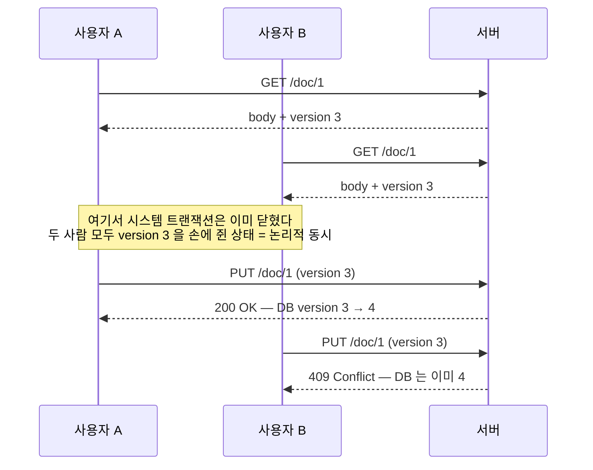

## 한 줄 정의

🟡 커밋 **직전에** 검증해서, 내가 읽은 뒤로 남이 바꾼 게 없을 때만 통과시킨다. 검증에 성공하는 것이 곧 락을 얻는 것이다 — *"A successful pre-commit validation is, in a sense, obtaining a lock."*

[[낙관적 락]]과 알고리즘은 같고 **적용 범위가 다르다.** 이쪽은 [[업무 트랜잭션과 시스템 트랜잭션|업무 트랜잭션]] 전체를 지킨다.

## 왜 필요한가

업무 트랜잭션이 여러 시스템 트랜잭션에 걸치는 순간 DB 매니저가 손을 뗀다. 원본이 드는 위험은 두 가지다.

- **lost update** — 두 세션이 같은 레코드를 만지기 시작하면 나중 저장이 앞선 저장을 덮는다 → [[Lost Update]]
- **inconsistent read** — 한 세션이 편집 중인 데이터를 다른 세션이 읽으면 읽은 값이 이미 낡았다

`@Version`을 붙여 놓았다고 이게 막히지 않는다. JPA의 낙관적 락은 **영속성 컨텍스트가 살아 있는 동안**만 버전을 들고 있는데, 응답이 나가면 그 컨텍스트는 사라진다.

## 어떻게 동작하는가



🟡 **검증과 갱신만 한 시스템 트랜잭션 안에 있으면 된다.** 조회까지 묶을 필요가 없다는 것이 이 패턴이 성립하는 이유다 — `UPDATE ... WHERE id = ? AND version = ?`의 affected rows가 0인지 1인지가 곧 검증 결과다.

🟢 그래서 **"동시"는 시간이 아니라 논리다.** 두 요청이 1초 차이든 10분 차이든, 같은 버전을 들고 왔다면 같은 충돌이다. 테스트에서 스레드를 띄우지 않고 순차 호출만으로 재현할 수 있는 근거이기도 하다.

## 코드에 닿는 지점

버전을 어디에 실어 보낼지는 두 갈래다. 표준 HTTP 의미론을 쓰면 `ETag` / `If-Match`가 그대로 이 패턴이다.

```java
@PutMapping("/{id}")
public ResponseEntity<Void> update(@PathVariable Long id,
                                   @RequestHeader("If-Match") long version,
                                   @RequestBody Dto dto) {
    service.update(id, dto, version);       // 내부는 UPDATE ... WHERE version = ?
    return ResponseEntity.ok().build();
}

@RestControllerAdvice
class ConflictHandler {
    @ExceptionHandler(ObjectOptimisticLockingFailureException.class)
    ResponseEntity<ErrorResponse> onConflict() {
        return ResponseEntity.status(CONFLICT)          // 409
                .body(new ErrorResponse("다른 사용자가 먼저 수정했습니다. 새로고침 후 다시 시도해 주세요."));
    }
}
```

**락 단위(입도)를 어디로 잡을지가 실제 설계다.** 애그리거트 루트에 버전 하나만 두면(= Coarse-Grained Lock) 연관 객체 묶음이 통째로 한 단위가 되어, 서로 무관한 영역을 편집하던 사용자까지 충돌 판정을 받는다. 화면이 탭으로 나뉘고 탭마다 독립 저장이 필요하면 버전도 그 단위로 쪼개야 한다.

## 트레이드오프

| Optimistic Offline | Pessimistic Offline |
|---|---|
| 충돌 확률이 **낮다**고 가정 | 높다고 가정 |
| 여러 사용자가 동시에 편집 가능 | 한 번에 하나 |
| 충돌은 **끝에서** 드러난다 | 시작에서 드러난다 |
| 운영 부담 없음 | 고아 락 해제 수단 필요 |

🔴 **가장 큰 대가는 실패 시점이다.** 충돌이 업무 트랜잭션 끝에서만 감지되므로, 30분 편집한 사람이 저장 버튼을 누르는 순간 전부 날린다. 원본의 경고가 강하다 — 긴 업무 트랜잭션에서 이게 잦으면 *"the system will soon become very unpopular."* 편집 시간이 긴 화면이라면 409를 띄우기 전에 **사용자 입력을 보존한 채 최신 데이터와 비교**할 수단을 함께 설계해야 한다.

## 연결

- [[업무 트랜잭션과 시스템 트랜잭션]] — 이 패턴이 필요해지는 조건
- [[Pessimistic Offline Lock]] — 같은 문제의 반대 답. 전제가 뒤집혀 있다
- [[낙관적 락]] — 시스템 트랜잭션 안에서 끝나는 형제. 알고리즘은 같다
- [[Lost Update]] — 이 패턴이 막는 것
- [[Coarse-Grained Lock]] — 락 단위를 애그리거트로 묶는 짝 패턴 (PoEAA 16장)
- 면접: [[JPA @Version과 Optimistic Offline Lock의 차이]]
- 종합: [[조회와 저장이 다른 요청일 때 무엇으로 막는가]]
- 실무 적용 기록 → `pages/private/`
