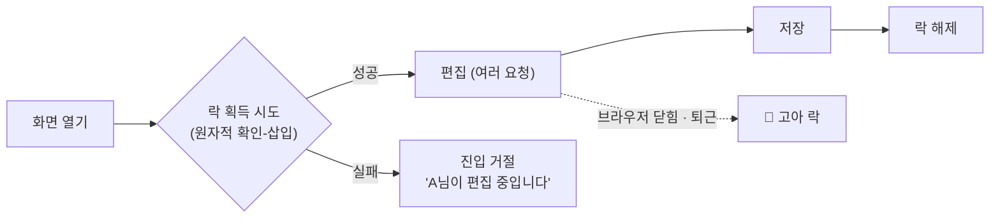

## 한 줄 정의

🟡 [[업무 트랜잭션과 시스템 트랜잭션|업무 트랜잭션]]이 데이터를 **쓰기 시작하기 전에** 락을 잡게 강제해서, 한 번에 하나만 접근하게 한다. 충돌을 감지하는 게 아니라 **아예 생기지 않게** 한다 — *"prevents conflicts by avoiding them altogether."*

## 왜 필요한가

[[Optimistic Offline Lock]]을 먼저 시도해 보라는 게 원본의 순서다(*"The first approach to try is Optimistic Offline Lock"*). 그런데 그 패턴에는 구조적 약점이 있다.

🔴 충돌이 **업무 트랜잭션 끝에서만** 드러난다. 여러 사람이 같은 데이터를 만지면 한 명은 쉽게 커밋하고 나머지는 실패하는데, 그 피해자들은 **작업을 전부 마친 뒤 마지막 순간에** 통째로 날렸다는 걸 알게 된다. 원본 표현대로 긴 업무 트랜잭션에서 이게 반복되면 *"the system will soon become very unpopular."*

편집에 30분이 걸리는 화면이라면, 저장 시점 거절보다 **처음부터 못 들어가게 막는 쪽**이 사용자에게 친절하다. 그 판단이 이 패턴을 고르는 이유다.

## 어떻게 동작하는가

락은 DB 행 락이 아니다. **별도의 락 테이블에 "이 대상은 누가 점유 중"이라는 레코드**로 관리한다. 시스템 트랜잭션이 여러 번 끊겼다 이어져도 살아 있어야 하기 때문이다.

```
lock_table
+------------+-----------+---------------------+
| owner_id   | owner     | acquired_at         |
+------------+-----------+---------------------+
| doc:1      | userA     | 2026-08-22 09:10:00 |   ← userB 는 진입 거절
```



락 획득 자체가 경합의 대상이므로 **유니크 제약이나 한 트랜잭션 안의 원자적 확인-삽입**으로 처리해야 한다. 확인하고 삽입하는 사이에 틈을 두면 락 관리자가 자기 문제를 자기가 만든다 → [[조건부 상태 전이 선점]]

## 코드에 닿는 지점

DB [[네임드 락]]이 이 패턴의 축소판이다 — 세션에 종속되므로 트랜잭션 여러 개를 가로지를 수 있고, 대신 커넥션을 붙잡고 있어야 한다. 애플리케이션 레벨로 올린 형태가 락 테이블이고, 인프라를 바꾸면 [[Redis 분산락]]이 같은 자리를 맡는다.

```java
// 락 테이블 방식 — 유니크 제약이 경합을 대신 판정한다
@Transactional
public boolean acquire(String resourceId, String owner) {
    try {
        lockRepository.save(new EditLock(resourceId, owner, Instant.now()));  // PK = resourceId
        return true;
    } catch (DataIntegrityViolationException e) {
        return false;                    // 이미 누가 점유 중
    }
}
```

## 트레이드오프

🔴 **고아 락(orphan lock)이 이 패턴의 실제 비용이다.** 사용자가 브라우저를 그냥 닫거나 퇴근해 버리면 락이 영원히 남는다. 만료 시간, 관리자 강제 해제, 세션 종료 감지 중 최소 하나는 반드시 붙여야 하고, 그게 그대로 운영 부담이 된다.

| 쓸 때 | 안 쓸 때 |
|---|---|
| 편집이 길어 실패 비용이 크다 | 편집이 짧다 → [[Optimistic Offline Lock]] |
| 같은 대상을 동시에 만질 확률이 높다 | 충돌이 드물다 |
| 진입 차단이 UX상 더 낫다 | 동시 편집 자체가 요구사항이다 |
| 고아 락 해제 수단을 운영할 수 있다 | 운영 복잡도를 늘릴 수 없다 |

🟡 판단 기준은 결국 하나다. **충돌 확률 × 잃는 작업량.** 확률이 낮으면 낙관, 잃는 양이 크면 비관.

## 연결

- [[업무 트랜잭션과 시스템 트랜잭션]] — 이 패턴이 필요해지는 조건
- [[Optimistic Offline Lock]] — 먼저 시도해 보라는 쪽. 전제가 반대다
- [[비관적 락]] — 이름이 닮았지만 트랜잭션에 종속되는 다른 층. 혼동 주의
- [[네임드 락]] — 세션 단위 DB 락. 이 패턴의 축소판
- [[Redis 분산락]] — TTL이 곧 고아 락 방어. 같은 문제의 인프라 버전
- [[조건부 상태 전이 선점]] — 락 획득을 원자적으로 만드는 방법
- 종합: [[조회와 저장이 다른 요청일 때 무엇으로 막는가]]
