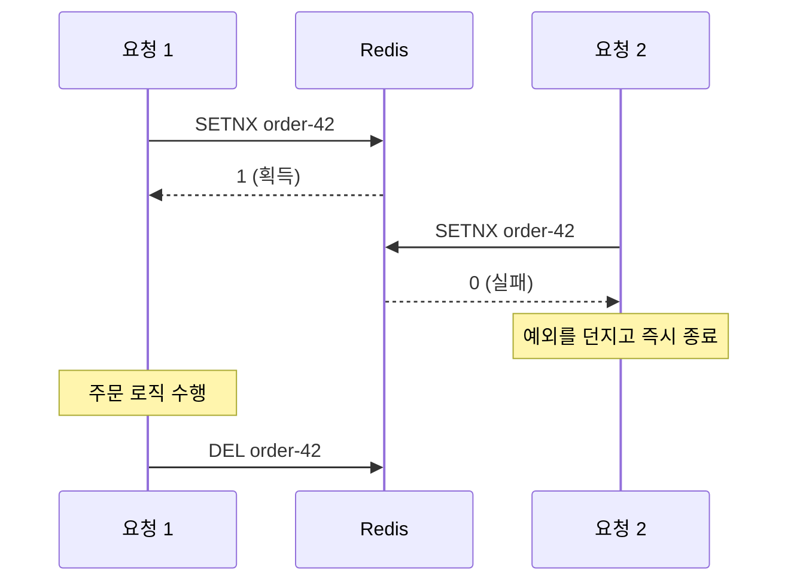

## 한 줄 정의

🟡 `SETNX`의 **"없을 때만 쓴다"** 성질 하나로 만드는 프로세스 바깥의 상호배제.

## 왜 필요한가

애플리케이션이 여러 대로 뜨는 순간 `synchronized`나 JVM 락은 소용이 없다. 프로세스 바깥에 있는 공유 저장소가 필요하다.

🟡 그런데 **분산락은 "동시에 한 개만"을 보장할 뿐 "정확히 한 번"을 보장하지 않는다.** [[멱등성]]의 상태 검사와 **함께** 써야 중복 실행이 실제로 막힌다.

| 장치 | 막는 것 |
|---|---|
| 분산락 | **동시** 요청 |
| 상태 검사 | **순차** 재요청 |

## 어떻게 동작하는가



🟢 락을 못 얻은 요청은 **기다리지 않고 바로 실패한다.** 중복 주문 방지가 목적이므로 대기시켜서 결국 실행하게 만들면 락을 건 의미가 없다.

## 코드에 닿는 지점

```java
public boolean tryLock(String key, String value) {
    return Boolean.TRUE.equals(
            redisTemplate.opsForValue().setIfAbsent(key, value, Duration.ofSeconds(10)));
}
```

키에 `order-monolithic-` 같은 고유 prefix를 붙이는 것은 취향이 아니라 **필수**다. prefix 없이 `orderId`만 쓰면 다른 도메인의 락과 키가 겹쳐 서로를 밀어낸다.

## 트레이드오프

🔴 **TTL 없는 락은 로직 수행 중 프로세스가 죽는 순간 영원히 남아**, 그 주문을 영구히 처리 불가 상태로 만든다.

🔴 해제는 반드시 `finally`에서. 그리고 **내가 건 락인지 값을 확인하고** 지워야 한다 — TTL이 먼저 만료되어 다른 요청이 락을 잡은 뒤에 늦게 도착한 `DEL`이 남의 락을 풀어 버릴 수 있다.

🔴 **락이 트랜잭션보다 바깥**이어야 한다. 트랜잭션이 바깥이면 커밋 전에 락이 풀려 다음 요청이 커밋 전 데이터를 본다.

로직이 TTL보다 길어질 가능성까지 고려하면 직접 만들기보다 [[Redisson 동작]]의 `RLock`(watchdog 갱신, 재진입)을 쓰는 쪽이 일반적이다.

**대기 vs 즉시 실패** — 목적에 따라 다르다. 중복 주문 방지가 목적이면 즉시 실패가 맞다.

💬 "Redis가 죽으면?"까지 오면 Redlock 논쟁 영역이다. "락 서버 장애 시 정책(요청 거부 vs 통과)을 정해 둬야 한다"까지만 말하고 선을 그어도 좋다.

## 실험으로 확인한 것

🟢 [[선착순 쿠폰 발급 동시성]] — Redis 분산락 **1312ms**, Redisson도 **1312ms**로 동일. 반면 Redis Lua 원자 차감은 **41ms**.

🔴 **분산락은 요청마다 네트워크 왕복 + 획득/해제 비용을 낸다.** 같은 Redis를 쓰면서도 락을 쓰느냐 원자 연산을 쓰느냐로 **30배** 차이가 났다. 단일 프로세스면 `synchronized`(933ms)가 더 싸다.

💬 "동시성 문제 = 분산락"으로 반사적으로 가면 이 비용을 매번 낸다.

## 패턴으로 보면

이 락이 하는 일은 [[Pessimistic Offline Lock]]과 같다 — **작업 전에 점유하고, 끝나면 푼다.** 다른 점은 락 저장소가 DB 테이블이 아니라 Redis이고, 고아 락 방어를 사람이 설계하는 대신 **TTL이 대신 맡는다**는 것이다.

🟡 그래서 "TTL을 얼마로 둘까"는 튜닝 값이 아니라 **고아 락을 언제 포기할지의 정책**이다. 락 테이블 방식에서 만료 시간·강제 해제·세션 감지를 직접 만들어야 하는 부담이 TTL 한 줄로 접힌 것.

## 연결

- [[Pessimistic Offline Lock]] — 같은 역할의 상위 패턴. TTL이 고아 락 방어를 대신한다
- [[네임드 락]] — 같은 일을 DB 안에서. 세션이 죽어야 풀린다
- [[선착순 쿠폰 발급 동시성]] — 위 수치의 출처
- [[원자적 UPDATE로 푸는 동시성]] — 락 없이 푸는 쪽
- [[멱등성]] — 함께 써야 하는 짝
- [[Redis 분산락의 함정]] — TTL 만료와 GC 정지가 겹칠 때
- [[Redisson 동작]] — watchdog, 재진입
- [[낙관적 락]] — 락 단위가 다른 문제([[Lost Update]])는 이걸로도 안 막힌다
- [[TCC]] · [[Saga 패턴]] — 코디네이터 방식에서 쓰인다 (Choreography에는 없다)
- 실험: [[선착순 쿠폰 발급 동시성]]
- 면접: [[분산락의 함정]]
