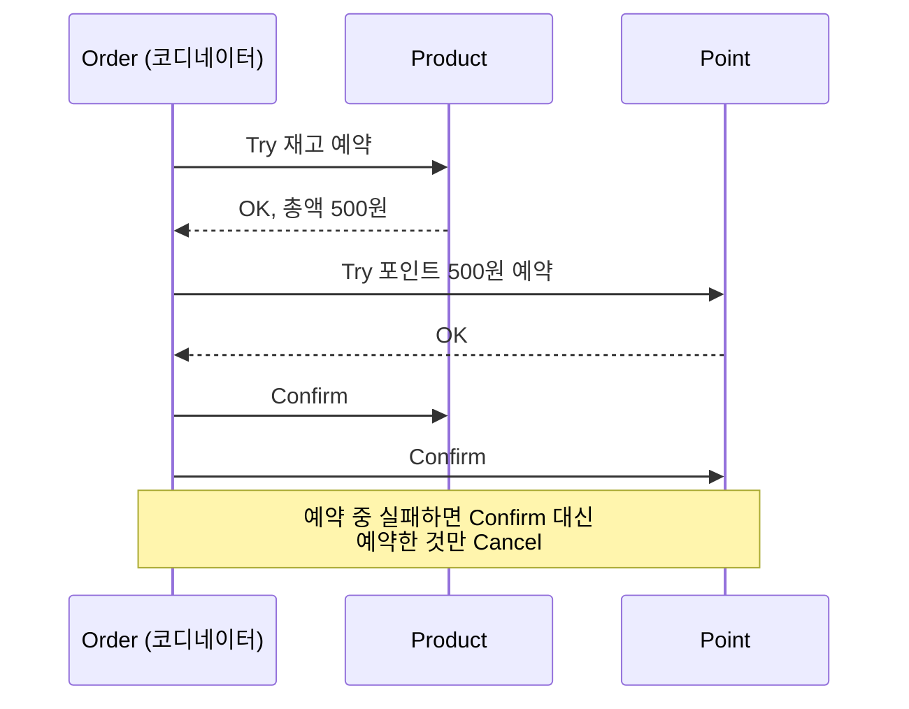

## 한 줄 정의

🟡 [[2PC]]의 Prepare/Commit을 **DB 프로토콜이 아니라 비즈니스 API로 다시 만든 것.** DB 락 대신 "예약됨"이라는 애플리케이션 상태로 자원을 붙든다.

## 왜 필요한가

2PC는 참여자가 락을 쥔 채 코디네이터를 기다린다. 그 대기가 가용성을 갉아먹는다.

TCC는 자원을 **DB 락이 아니라 애플리케이션 상태로** 붙든다. 그래서 각 서비스는 **짧은 로컬 트랜잭션만** 쓰면 된다. Try가 끝나면 커밋하고 락을 놓는다 — 붙들려 있는 것은 "예약됨"이라는 데이터일 뿐이다.

## 어떻게 동작하는가

| 단계 | 하는 일 |
|---|---|
| **Try** | 점유 가능한지 검사하고, 가능하면 **임시로 예약** |
| **Confirm** | 예약을 확정해 실제로 DB에 반영 |
| **Cancel** | 예약 도중 에러가 나면 예약을 취소해 원복 |



상태 전이는 한 방향이다 — `RESERVED` → `CONFIRMED` 또는 `CANCELED`. **이미 확정된 예약은 취소할 수 없고, 이미 취소된 예약은 확정할 수 없다.** 이 단방향성이 [[멱등성]] 판정을 단순하게 만든다.

## 코드에 닿는 지점

예약 레코드만으로는 부족하다. 재고가 1개인데 두 명이 예약하면 둘 다 "성공"을 받는다. 그래서 **예약된 수량 컬럼**을 따로 둔다.

```java
public long reserve(long requestQuantity) {
    long available = this.quantity - this.reservedQuantity;   // ← 예약분을 뺀 여유분
    if (available < requestQuantity) throw new IllegalStateException("예약 가능 수량 부족");
    this.reservedQuantity += requestQuantity;
    return this.price * requestQuantity;                      // 예약 당시 금액
}

public void confirm(long quantity) {
    if (this.quantity < quantity || this.reservedQuantity < quantity)
        throw new IllegalStateException("확정 불가");
    this.quantity -= quantity;          // ← 이때 비로소 실제 재고가 준다
    this.reservedQuantity -= quantity;
}
```

🟡 `reserve()`가 검사하는 것은 `quantity`가 아니라 `quantity - reservedQuantity`다. **이 한 줄이 "DB 락 대신 애플리케이션 상태로 자원을 붙든다"의 실체다.**

🟢 예약 시점의 금액(`price * quantity`)을 예약 레코드에 함께 저장한다. Try와 Confirm 사이에 가격이 바뀌어도 확정은 예약 당시 조건으로 이뤄져야 한다.

🔴 `confirm()`이 **둘 다** 검사하는 이유를 놓치기 쉽다. 재고만 검사하면 예약하지 않은 요청이 확정을 밀어 넣을 수 있고, 예약분만 검사하면 다른 경로로 재고가 소진된 상황을 못 잡는다.

## 트레이드오프

| 쓸 때 | 안 쓸 때 |
|---|---|
| 중간 상태 노출이 곧 사고인 영역 (결제·정산) | 최종적 일관성을 감당할 수 있는 대부분의 서비스 |
| 확정 전까지 남에게 안 보여야 함 | 예약 API 3벌을 만들 여력이 없음 |

🔴 **다 구현해도 잔여 상태가 남는다.**

**① Confirm 도중 실패 → 주문 `PENDING`.** 자동 확정하고 싶어지지만 위험하다. 고객이 오류를 만나 재주문해 정상 완료한 뒤 앞선 `PENDING`을 자동 확정하면 **같은 물건을 두 번 산 결과**가 된다. 🟡 보편적 처방은 자동화가 아니라 **사람에게 넘기는 것**이다.

**② 취소가 도달 못 해 자원이 `RESERVED`로 남음.** 🟢 이쪽은 자동화가 된다 — 참여자가 주기적으로 오래된 `RESERVED`를 찾아 Order에 주문 상태를 물어보고, 취소 상태면 스스로 예약을 취소한다.

💬 두 처방이 갈리는 이유는 **판단의 여지**다. 확정은 되돌릴 수 없고 비즈니스 맥락에 따라 답이 달라지지만, 취소는 "주문이 이미 취소됨"이라는 사실 하나로 판정이 끝난다.

## 실험으로 확인한 것

🟢 [[TCC 실험]]이 [[2PC 실험]]과 **같은 자리에 같은 SQL을 놓고** 결과가 뒤집히는 걸 보인다.

| | 2PC (`XA PREPARE` 후) | TCC (Try 후) |
|---|---|---|
| 같은 행 UPDATE | `ERROR 1205` | **통과** |
| 같은 행 SELECT | 커밋 전 옛 값 `0` | 잡힌 값 `2` 그대로 |

🟡 Try에서 이미 커밋했으니 **쥐고 있는 락 자체가 없다.** 코디네이터가 늦든 죽든 다른 요청은 멀쩡하다.
🔴 대신 읽는 쪽은 확정되지 않은 값을 본다 — **격리를 포기한 것이다.**

상태 로그(`TRIED`/`CONFIRMED`/`CANCELLED`) 없이 깨지는 네 가지도 재현됐다: Confirm 2회 → 초과 판매 / Cancel 2회 → `held_count` 음수 / 빈 취소 → 매달림.

## 연결

- [[TCC 실험]] — 위 대조표를 직접 돌려본 것
- [[2PC]] — TCC가 비즈니스 API로 옮겨 온 원형
- [[Saga 패턴]] — 예약 단계를 아예 없앤 쪽
- [[멱등성]] — Try·Confirm·Cancel 전부 멱등이어야 한다
- [[낙관적 락]] — 서로 다른 주문이 같은 상품을 예약할 때 필요
- [[실패 사실의 기록]] — `PENDING` 잔여를 감시 가능하게
- [[분산 트랜잭션 네 가지 비교]]
- 실험: [[TCC 실험]]
- 면접: [[TCC는 2PC의 무엇을 해결하나]]
