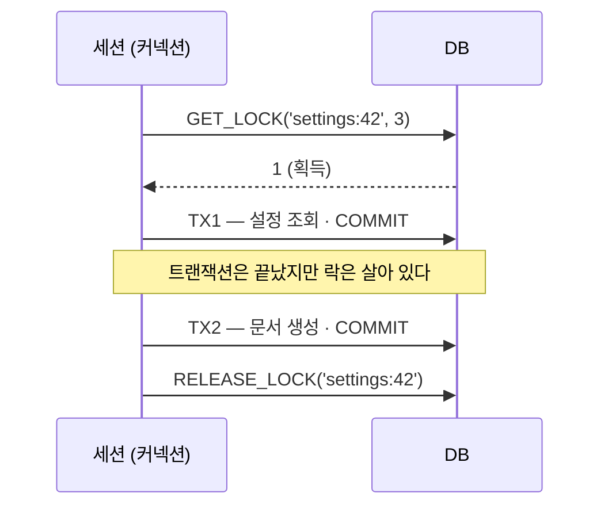

## 한 줄 정의

🟡 DB를 **락 저장소**로 쓰는 방식. 특정 이름의 자원에 배타적 뮤텍스를 거는 것이고, 잠그는 대상이 로우가 아니라 **문자열**이다. 결정적 차이는 [[비관적 락]]과 달리 **트랜잭션이 아니라 세션에 종속된다**는 점이다.

```sql
SELECT GET_LOCK('doc:1', 3);     -- 3초 대기, 얻으면 1
-- ... 여러 트랜잭션이 커밋되고 롤백돼도 락은 유지된다 ...
SELECT RELEASE_LOCK('doc:1');    -- 명시적으로 풀어야 풀린다
```

## 왜 필요한가

락의 수명이 어디에 묶이는지가 곧 쓸 수 있는 자리를 정한다.

| | 트랜잭션 종속 | 세션 종속 |
|---|---|---|
| 예 | `SELECT ... FOR UPDATE` | `GET_LOCK` |
| 언제 풀리나 | 커밋·롤백 순간 자동 | 명시적 해제 또는 커넥션 종료 |
| 여러 트랜잭션 가로지르기 | ❌ | ✅ |

🟡 그래서 **"조회하고, 시간이 흐르고, 그다음 생성"** 같은 흐름은 [[비관적 락]]으로 못 막는다. 조회 트랜잭션이 커밋되는 순간 락이 사라지기 때문이다. 이 구간을 잠그려면 [[업무 트랜잭션과 시스템 트랜잭션|경계를 넘어 살아남는 락]]이 필요하고, 네임드 락이 그 조건을 만족한다. [[Pessimistic Offline Lock]]을 DB 기능으로 구현한 축소판이라고 보면 맞다.

로우가 아직 없는 대상(생성 전 자원, 범위 전체, 잡 실행 권한)을 잠글 수 있다는 것도 로우 락과의 실질적인 차이다.

## 어떻게 동작하는가



**락을 쥔 주체가 커넥션**이라는 사실이 모든 제약의 출처다.

## 코드에 닿는 지점

🔴 **커넥션 풀과 정면으로 부딪힌다.** 락을 잡은 커넥션과 실제 업무 쿼리를 실행하는 커넥션이 달라지면 락이 아무것도 보호하지 못한다. 그래서 실무에서는 락 전용 데이터소스를 따로 두거나 같은 커넥션을 강제로 유지해야 하고, 락을 오래 쥘수록 **커넥션 하나가 그동안 묶인다.**

```java
@Transactional(propagation = Propagation.REQUIRES_NEW)   // 락 획득/해제를 업무 트랜잭션과 분리
public <T> T withNamedLock(String key, int timeoutSec, Supplier<T> work) {
    if (lockRepository.getLock(key, timeoutSec) != 1) {
        throw new LockAcquisitionException(key);
    }
    try {
        return work.get();
    } finally {
        lockRepository.releaseLock(key);                  // finally 없으면 그대로 고아 락
    }
}
```

> ❓ 확인 필요: 위 동작은 MySQL `GET_LOCK` 기준이다. **한 세션이 동시에 여러 네임드 락을 쥘 수 있는지, 커넥션 풀 반납 시 락이 자동 해제되는지는 DBMS·버전마다 다르다.** MySQL 5.7 이전은 세션당 락 1개만 허용했다. 실제 도입 전에 쓰는 버전의 문서로 대조할 것.

## 트레이드오프

| 쓸 때 | 안 쓸 때 |
|---|---|
| 여러 트랜잭션을 하나로 묶어 보호해야 한다 | 한 트랜잭션 안에서 끝난다 → [[비관적 락]] |
| 잠글 로우가 아직 없다 | 로우가 있고 그것만 막으면 된다 |
| Redis 같은 추가 인프라를 들이기 싫다 | 이미 Redis가 있다 → [[Redis 분산락]] |
| 편집 시간이 짧고 예측 가능하다 | 사람이 화면을 붙잡는 시간이 낀다 → [[Optimistic Offline Lock]] |

🔴 **타임아웃 없는 네임드 락은 쓰지 않는다.** 사용자가 화면을 열어 두고 딴짓하면 그 시간만큼 다른 사람이 통째로 막힌다. 획득 대기 타임아웃과 보유 시간 상한을 둘 다 정해야 하고, 그게 없으면 [[Pessimistic Offline Lock]]의 고아 락 문제가 그대로 재현된다.

🔴 DB에 부하가 몰린다. 락 트래픽이 곧 DB 트래픽이라 인스턴스가 늘수록 DB가 병목이 된다.

## 연결

- [[비관적 락]] — 트랜잭션 종속. 이 페이지와 대비되는 축
- [[Pessimistic Offline Lock]] — 이 락이 구현하는 상위 패턴
- [[업무 트랜잭션과 시스템 트랜잭션]] — 세션 종속이 필요해지는 이유
- [[Redis 분산락]] — 같은 역할을 DB 밖에서. TTL이 고아 락을 대신 막는다
- [[Optimistic Offline Lock]] — 점유 대신 검증으로 푸는 반대편
