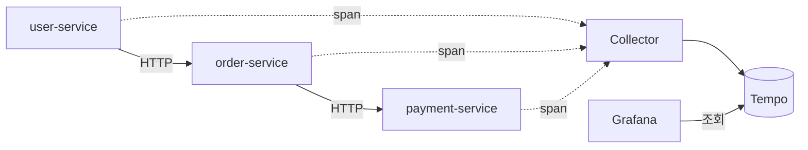

## 한 줄 정의

여러 서비스를 건너다니는 요청 하나에 같은 식별자를 물려, **흩어진 로그 조각을 한 흐름으로 다시 꿰는 것**.

## 왜 필요한가

모놀리식에서는 "이 요청 왜 느렸지"를 스택트레이스 하나로 답할 수 있다. 서비스가 셋으로 갈라지는 순간 그게 불가능해진다. user → order → payment로 이어지는 호출에서 느린 구간이 어디인지, 각 서비스 로그를 따로 열어서는 알 수 없다. 시각만 보고 짝을 맞춰야 하는데, 동시 요청이 섞이면 그마저 안 된다.

🟡 **문제는 로그가 없는 게 아니라 로그를 이을 열쇠가 없는 것이다.** 분산 추적은 그 열쇠(trace id)를 요청 진입점에서 만들어 하위 호출에 전파한다.

[[원장 대사]]가 "내 기록과 바깥 기록을 짝짓는 문제"였다면 이쪽은 "내 서비스들의 기록끼리 짝짓는 문제"다. 둘 다 **식별자 설계가 절반**이라는 점이 같다.

## 어떻게 동작하는가

길이 두 개로 나뉜다. 이 분리가 핵심이다.



- **실선 = 실제 서비스 호출.** 요청이 실제로 흐르는 길
- **점선 = 트레이스 전송.** 기록이 빠져나가는 길

🟡 **두 길이 별개라서 Collector가 죽어도 서비스는 계속 돈다.** 관측 장치가 서비스의 장애 지점이 되지 않게 하는 게 이 구조의 목적이다.

용어는 셋이면 충분하다.

| 용어 | 뜻 |
|---|---|
| Span | 작업 한 구간의 기록. 시작·끝 시각과 속성을 가진다 |
| Trace | 같은 요청에 속한 Span들의 묶음 |
| Collector | 앱과 저장소 사이에서 받아 모아 넘기는 중계 |

Collector를 왜 끼우냐면, 앱이 저장소로 직접 쏘면 저장소 주소·프로토콜·배치 정책이 전부 앱 설정이 되기 때문이다. 중계를 두면 그게 한 곳에 모인다. 실습 구성에서도 Tempo의 수신 포트를 호스트에 열지 않아 **반드시 Collector를 거치게** 강제했다.

## 코드에 닿는 지점

🟢 **이 실습에서 가장 놀란 부분**: `build.gradle.kts`에 OpenTelemetry 의존성이 **한 줄도 없다.** 애플리케이션 코드도 안 고친다.

```dockerfile
RUN wget -O /opt/opentelemetry-javaagent.jar \
    https://github.com/open-telemetry/opentelemetry-java-instrumentation/releases/latest/download/opentelemetry-javaagent.jar
CMD ["java", "-javaagent:/opt/opentelemetry-javaagent.jar", "-jar", "app.jar"]
```

계측은 전부 **Java Agent가 런타임에 바이트코드를 조작해서** 붙인다. 설정도 코드가 아니라 환경변수다.

```
OTEL_EXPORTER_OTLP_ENDPOINT=http://otel-collector:4317
OTEL_SERVICE_NAME=user-service
OTEL_TRACES_EXPORTER=otlp
OTEL_METRICS_EXPORTER=none
```

Spring MVC·RestTemplate·JDBC 같은 표준 지점은 에이전트가 알아서 잡는다. 직접 코드를 넣는 건 **도메인 의미가 있는 구간**(결제 승인 한 건, 정산 배치 한 사이클)을 따로 Span으로 끊고 싶을 때다.

## 트레이드오프

🔴 **에이전트 방식은 공짜가 아니다.**

| | 얻는 것 | 잃는 것 |
|---|---|---|
| Java Agent | 코드·의존성 변경 0. 표준 프레임워크는 자동 계측 | 시작 시간 증가, 런타임 오버헤드. 무엇이 계측됐는지 코드에서 안 보인다 |
| 수동 계측 | 도메인 단위로 정확히 끊는다 | 코드에 관측 코드가 섞인다. 빠뜨리면 구멍이 생긴다 |

- **전량 수집은 비싸다.** 트래픽이 크면 샘플링이 필요하고, 샘플링하는 순간 "그 느렸던 요청"이 안 잡힐 수 있다.
- **추적은 지표가 아니다.** [[Micrometer 계측기 선택]]이 다루는 Counter/Gauge/Timer는 "얼마나 많이·얼마나 오래"를 집계하고, 추적은 "이 한 건이 어디를 어떻게 지나갔나"를 본다. 🔴 실습 구성도 `OTEL_METRICS_EXPORTER=none`으로 **트레이스만** 켰다. 둘은 같이 쓰는 것이지 대체재가 아니다.
- 🔴 이 실습에는 **수치가 없다.** 오버헤드가 실제로 얼마인지는 재 보지 않았다. `deep-dive`에서 에이전트 유무로 p95를 비교하면 lab 페이지가 될 수 있다.

## 연결

- [[Micrometer 계측기 선택]] — 같은 관측이지만 축이 다르다. 지표 vs 추적
- [[원장 대사]] — 식별자로 흩어진 기록을 짝짓는다는 점이 같다
- [[결과 불명 상태]] — `UNKNOWN`으로 끝난 결제가 실제로 어디까지 갔는지 추적으로 본다
- [[Bulkhead]] — 관측 경로와 서비스 경로를 가르는 것도 자원 격리의 일종이다
- [[컨슈머 그룹과 리밸런싱]] — Consumer Lag는 지표 쪽이고, 메시지 한 건의 여정은 추적 쪽이다
