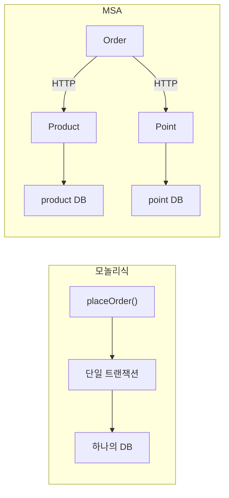

## 한 줄 정의

🟡 `@Transactional`이 여는 것은 **커넥션 하나의 트랜잭션**이다. 서비스를 쪼개 DB가 갈라지는 순간, 그 한 줄이 대신해 주던 원자성이 사라진다.

## 왜 필요한가

주문 하나에 세 데이터가 걸린다 — 주문·재고·포인트.

🟡 "정합성이 맞는다"는 **세 데이터가 각각 옳다**는 뜻이 아니라 **서로 모순되지 않는다**는 뜻이다. 주문이 성공했으면 재고와 포인트도 반드시 빠져 있어야 한다.

단일 DB에서는 `@Transactional` 한 줄로 끝난다. 세 번의 `save()`가 하나의 트랜잭션으로 묶이고, 마지막에서 터지면 앞의 둘도 롤백된다.

🔴 **그런데 이건 세 도메인이 같은 DB를 쓴 덕에 공짜로 얻어진 것뿐이다.** DB를 셋으로 나누는 순간 Order 서버의 트랜잭션은 `order-example` 커넥션 하나에만 걸려 있고, Product 서버가 자기 DB에서 무엇을 커밋하든 알지도 되돌리지도 못한다.

## 어떻게 동작하는가



왼쪽에서 트랜잭션 경계는 메서드 하나였다. 오른쪽에서는 서버마다 따로 있고, **그 사이를 잇는 것은 트랜잭션이 아니라 네트워크**다.

🟢 그래서 실패의 종류가 늘어난다. 모놀리식에서는 "성공 또는 실패"였지만 네트워크 호출은 **성공 · 실패 · 알 수 없음** 셋이다. 타임아웃이 났을 때 상대가 처리를 안 한 건지, 처리는 했는데 응답만 못 온 건지 호출한 쪽은 구분할 수 없다.

💬 이 세 번째 상태가 이후 모든 설계의 골칫거리다. [[멱등성]]이 필요한 근본 이유가 여기 있다.

## 코드에 닿는 지점

```java
@Transactional                       // 프록시가 앞뒤에 시작·커밋을 끼운다
public void placeOrder(PlaceOrderCommand command) {
    orderRepository.save(new Order());
    productService.buy(...);
    pointService.use(...);           // 여기서 터지면 위가 전부 롤백 — 단일 DB일 때만
}
```

🟡 원자성은 **"전부 성공하거나 전부 실패한다"를 보장하는 것이지 실패하지 않게 해 주는 것이 아니다.** 실패는 그대로 일어나고 흔적만 남기지 않는다.

## 트레이드오프

MSA의 장점과 단점은 **같은 뿌리(독립성)**에서 나온다.

| | 모놀리식 | MSA |
|---|---|---|
| 배포 | 전체 한 번 | 서비스별 |
| 확장 | 전체를 함께 | 필요한 것만 |
| 트랜잭션 | 단일 DB면 쉬움 | **하나로 묶을 수 없음** |

🔴 "MSA가 더 나은 아키텍처"가 아니다. 작은 서비스·작은 팀에서는 운영 복잡도만 는다. [[2PC]] · [[TCC]] · [[Saga 패턴]]이 푸는 문제 전부가 **모놀리식에서는 애초에 존재하지 않던 문제**다.

## 연결

- [[2PC]] — DB에게 원자성을 맡기는 방법
- [[TCC]] — 애플리케이션이 예약으로 붙드는 방법
- [[Saga 패턴]] — 즉시 실행하고 되돌리는 방법
- [[분산 트랜잭션 네 가지 비교]] — 셋 중 무엇을 고를 것인가
- [[멱등성]] — "알 수 없음" 상태를 감당하는 전제
- 실험: [[분산 트랜잭션 기준선 - 모놀리식]] → [[분산 트랜잭션 기준선 - MSA]]
- 면접: [[MSA에서 트랜잭션은 어떻게 관리하나]]
