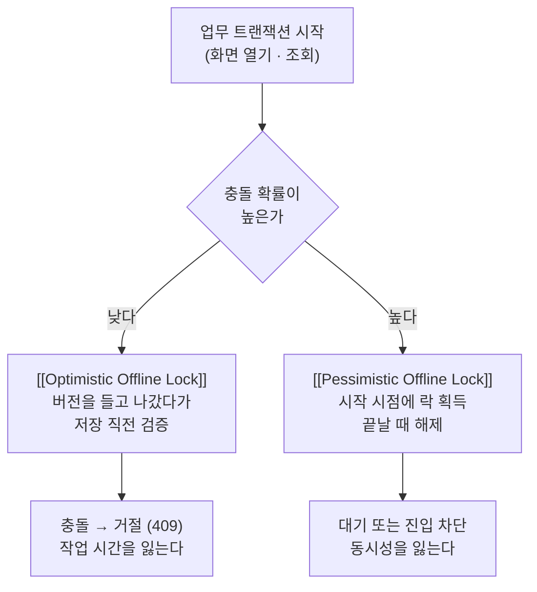

## 한 줄 정의

🟡 사용자가 "하나의 작업"이라고 느끼는 단위(**업무 트랜잭션**)와 DB가 원자성을 보장해 주는 단위(**시스템 트랜잭션**)는 대개 일치하지 않는다. 이 볼트의 동시성 페이지 대부분은 둘이 일치한다고 전제하고 쓰여 있다 — 이 페이지는 그 전제가 깨지는 자리를 다룬다.

| | 업무 트랜잭션 | 시스템 트랜잭션 |
|---|---|---|
| 경계 | 화면을 열고 → 편집하고 → 저장을 누를 때까지 | `BEGIN` ~ `COMMIT` |
| 길이 | 수 초 ~ 수십 분 (사람의 속도) | 수 밀리초 (기계의 속도) |
| 보장 주체 | **애플리케이션** | DB 매니저 |
| Spring에서 | 없음. 이름이 없다 | `@Transactional` 한 개 |

## 왜 필요한가

조회와 저장이 별도 HTTP 요청이면 그 사이에 트랜잭션은 이미 닫혀 있다. Fowler의 표현대로 *"Once outside the confines of a single system transaction, we can't depend on our database manager alone."* 요청 A가 응답을 내보내는 순간 커넥션은 풀로 돌아가고, 그때부터 [[Lost Update]]를 막아 주는 것은 아무것도 없다.

그렇다고 업무 트랜잭션 전체를 시스템 트랜잭션 하나로 열 수도 없다.

🔴 트랜잭션 시스템은 **장기 트랜잭션에 맞게 만들어져 있지 않다.** 사람이 화면을 보는 5분 동안 커넥션 하나가 붙잡혀 있으면 커넥션 풀이 먼저 고갈되고, 그 한 명 때문에 나머지 요청이 커넥션을 못 잡는다. 원본이 이 방식을 *"doesn't always work well"*이라고 잘라 말하는 이유다.

## 어떻게 동작하는가

정합성을 지키는 책임이 DB에서 애플리케이션으로 넘어온다. 두 갈래뿐이다.



어느 쪽이든 상태를 **시스템 트랜잭션 밖에 보관**해야 한다는 점은 같다. 버전 값을 클라이언트가 들고 다니거나, 락 레코드를 별도 테이블에 남기거나.

## 코드에 닿는 지점

같은 `@Version` 컬럼이라도 어느 단위를 지키느냐가 다르다.

```java
// (1) 시스템 트랜잭션 안 — JPA 낙관적 락
@Transactional
public void update(Long id, Dto dto) {
    Entity e = repository.findById(id).orElseThrow();  // 여기서 version 읽고
    e.apply(dto);                                      // 같은 트랜잭션에서 flush
}                                                       // 충돌 창은 수 밀리초

// (2) 업무 트랜잭션 전체 — Optimistic Offline Lock
@GetMapping("/{id}")                      // 요청 1: version 을 응답에 실어 내보낸다
public Response get(@PathVariable Long id) { ... }

@PutMapping("/{id}")                      // 요청 2: 사용자가 들고 있던 version 을 받는다
public Response update(@PathVariable Long id,
                       @RequestHeader("If-Match") long version,   // ← 경계를 넘어온 상태
                       @RequestBody Dto dto) { ... }
```

🟡 (2)에서 `version`이 **HTTP 응답 → 브라우저 → HTTP 요청**을 거쳐 돌아온다는 것이 핵심이다. 트랜잭션이 못 넘는 경계를 값이 대신 넘는다.

## 트레이드오프

| 업무 트랜잭션을 한 시스템 트랜잭션으로 | 쪼개고 애플리케이션이 보장 |
|---|---|
| 코드가 단순하다 | 버전·락 상태를 직접 관리해야 한다 |
| 커넥션·락 점유가 사람 속도에 묶인다 | 점유는 밀리초 단위로 끝난다 |
| 요청이 하나일 때만 가능 | 요청이 여러 개여도 된다 |

🔴 "요청이 여러 개"라는 조건은 선택이 아니라 **구조가 이미 정해 버린 것**이다. 조회 API와 저장 API가 따로 있으면 그 시점에 이미 시스템 트랜잭션 하나로 묶을 방법이 없다 — `@Transactional`은 메서드 호출 범위에서만 걸리기 때문. 그래서 이건 "어떤 락을 쓸까"의 문제가 아니라 **경계를 넘는 수단을 무엇으로 둘까**의 문제다.

## 연결

- [[Optimistic Offline Lock]] — 경계를 넘는 수단이 버전 값일 때
- [[Pessimistic Offline Lock]] — 경계를 넘는 수단이 락 레코드일 때
- [[낙관적 락]] — 같은 버전 비교지만 시스템 트랜잭션 안에서 끝나는 쪽
- [[네임드 락]] — 세션에 종속되어 트랜잭션 여러 개를 가로지르는 DB 락
- [[Saga 패턴]] — 여러 **서비스**에 걸친 업무 트랜잭션. 여기는 한 서비스 안
- [[프록시 자기호출 문제]] — `@Transactional`의 경계가 어디까지인지의 다른 얼굴
