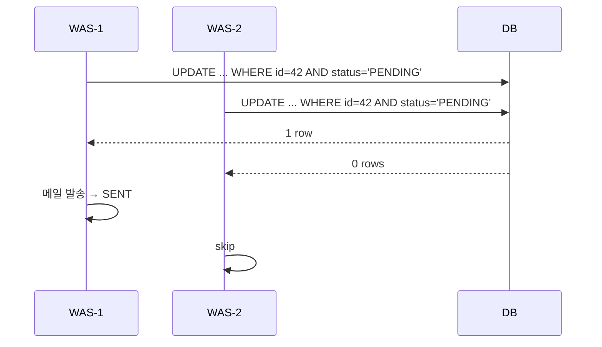

> 스키마가 실제로 어떻게 채워지는지 보여주는 예시 페이지. 형식이 익숙해지면 지워도 된다.

## 한 줄 정의

🟡 여러 인스턴스가 같은 작업 큐를 볼 때, **"조회 후 처리"가 아니라 "조건부 UPDATE에 성공한 쪽만 처리"**하게 만들어 중복 처리를 막는 방법.

## 왜 필요한가

WAS가 2대 이상인 환경에서 각 인스턴스의 스케줄러가 같은 테이블을 폴링하면, 두 인스턴스가 **같은 `PENDING` 행을 동시에 읽는다.**

```
[WAS-1] SELECT ... WHERE status='PENDING'  → id=42
[WAS-2] SELECT ... WHERE status='PENDING'  → id=42   ← 같은 행
[WAS-1] 메일 발송
[WAS-2] 메일 발송                                    ← 중복
```

읽기와 처리 사이에 틈이 있어서 생기는 문제다. 🔴 이 틈은 `SELECT`를 아무리 정교하게 짜도 안 없어진다 — 읽기는 다른 트랜잭션의 읽기를 막지 않기 때문.

## 어떻게 동작하는가

처리 전에 **상태를 조건부로 바꾸고, 바뀐 행 수가 1인 쪽만** 실제 작업을 한다.

```sql
UPDATE email_request
   SET status = 'PROCESSING'
 WHERE id = ? AND status = 'PENDING';
```

`UPDATE`는 행 락을 잡으므로 둘 중 하나만 통과한다. 진 쪽은 `updatedRows = 0`을 받고 조용히 빠진다.



## 코드에 닿는 지점

```java
@Modifying
@Query("""
    update EmailRequest e
       set e.status = 'PROCESSING'
     where e.id = :id and e.status = 'PENDING'
    """)
int claim(@Param("id") Long id);
```

```java
if (repository.claim(id) == 1) {   // 선점 성공한 인스턴스만
    send(id);
}
```

🟢 별도 MQ나 범용 Outbox 인프라 없이도 발송 요청 테이블 + 조건부 선점만으로 재시도 가능한 발송을 구성할 수 있다.

## 트레이드오프

| 쓸 때 | 안 쓸 때 |
|---|---|
| 인스턴스가 2대 이상이고 같은 큐를 폴링 | 인스턴스가 1대거나 이미 MQ가 있음 |
| MQ를 새로 들이기엔 인프라 비용이 큼 | 처리량이 커서 DB 폴링 자체가 병목 |
| 중복 처리가 "조용한 실패"보다 나음 | 정확히 한 번이 반드시 필요함 |

🔴 **정확히 한 번을 보장하지 않는다.** 발송 성공 후 `SENT`로 바꾸기 전에 죽으면 재시도 때 중복 발송된다. DB와 메일 서버는 서로 다른 리소스라 한 트랜잭션으로 묶을 수 없기 때문. → [[정확히 한 번 전달의 불가능성]]

💬 그래서 이 설계의 진짜 선택은 "중복 발송 vs 조용한 유실" 중 **중복을 고른 것**이다. 면접에서 이 지점을 물어보면 여기를 말해야 한다.

🔴 `PROCESSING`으로 바꿔놓고 죽으면 그 행은 **영원히 매달린다.** 처리 타임아웃(`PROCESSING`인 채로 N분 경과 시 `PENDING`으로 되돌리기)이 같이 있어야 완성이다.

## 연결

- [[비관적 락]] — `SELECT ... FOR UPDATE`로도 풀 수 있지만 락을 쥐는 시간이 길어진다
- [[원자적 UPDATE로 푸는 동시성]] — 같은 아이디어를 재고 차감에 적용한 것
- [[Outbox 패턴]] — 이 방식의 일반화된 형태
- [[멱등성]] — 같은 문제(중복 처리)를 **서비스 경계를 넘어** 이력 테이블로 푸는 방식. 이쪽은 DB 한 대 안에서 원자적 UPDATE로 푼다
- [[커밋 후 이벤트 발행]] — 발송 요청을 DB에 남기고 커밋 뒤 처리하는 같은 계열의 설계
- [[Lost Update]] — 읽고-쓰는 틈이 만드는 다른 얼굴
- 실험: [[선착순 쿠폰 발급 동시성]] — 원자적 UPDATE와 락 방식들의 처리량 비교
- 실무: 비공개 판단 기록
- 면접: [[정확히 한 번 전달이 가능한가]] · [[중복 처리를 어떻게 막았나]]
- MOC: [[MOC-동시성]]
