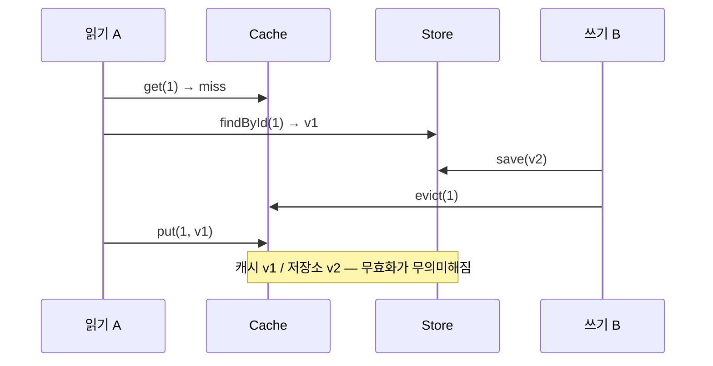

## 한 줄 정의

🟡 [[Cache Aside]]에서 **읽기가 miss를 확인하고 캐시에 넣기까지의 틈**에 쓰기가 끼어들면, 오래된 값이 뒤늦게 캐시에 들어가 눌러앉는다.

## 왜 필요한가

캐시 무효화를 정확히 해도 이 문제는 남는다. **`evict`가 먼저 실행됐는데도 그 뒤에 옛 값이 들어온다.** 무효화 코드를 아무리 봐도 원인이 안 보이는 종류의 버그다.

## 어떻게 동작하는가



🟢 `StaleCachePutRaceTest`가 정확히 이 순서를 재현한다. 쓰기 B는 할 일을 다 했는데도 결과가 틀린다.

💬 [[Lost Update]]와 구조가 같다 — **읽고-계산하고-쓰는 사이의 틈.** 다만 여기서는 "쓰는 대상"이 DB가 아니라 캐시다.

## 코드에 닿는 지점

**버전을 붙여 역행 쓰기를 거부한다.**

```java
// VersionedCache: 더 낮은 버전의 put 을 거부
cache.put(key, value, version);
cache.rejectedPuts();   // 거부 횟수를 노출해 관찰 가능하게
```

🟢 거부 횟수를 **밖으로 드러낸 게 중요하다.** 이 값이 0이 아니면 실제로 경합이 일어나고 있다는 뜻이고, 0이면 방어가 필요 없었다는 뜻이다 → [[실패 사실의 기록]]과 같은 사고방식.

다른 처방:

- **Write Through** — 쓰기가 캐시를 직접 최신으로 만든다 → [[캐시 쓰기 전략]]
- **짧은 TTL** — 틀린 값의 수명을 제한한다. 근본 해결은 아니지만 피해를 유한하게 만든다
- **Delayed Double Delete** — 쓰기 후 잠시 뒤 한 번 더 `evict`

## 트레이드오프

🔴 **버전 관리는 캐시에 상태를 하나 더 만든다.** 값과 버전이 함께 저장돼야 하고, 버전 출처(엔티티 `@Version`, `updatedAt`)가 필요하다.

🔴 **TTL로 때우는 건 문제를 짧게 만들 뿐이다.** TTL 동안은 틀린 값이 서빙된다. 금액·재고처럼 틀리면 안 되는 데이터에는 부족하다.

🔴 **Delayed Double Delete는 지연 시간을 추측해야 한다.** 너무 짧으면 안 잡히고 길면 캐시 효율이 떨어진다.

## 연결

- [[Cache Aside]] — 이 문제의 고유한 발생 구조
- [[Lost Update]] — 같은 "읽고-쓰기 사이의 틈" 구조
- [[캐시 쓰기 전략]] — Write Through가 대안
- [[낙관적 락]] — 버전으로 역행을 막는 같은 아이디어
- 실험: [[캐시 패턴 비교]] — `StaleCachePutRaceTest`, `VersionedCache`
