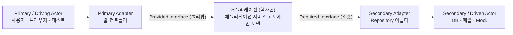

## 한 줄 정의

> 🟡 **포트는 명확한 목적과 방향을 가진 인터페이스이고, 어댑터는 액터가 그 포트에 직접 연결할 수 없을 때 모양을 맞춰 주는 것이다.**

🟢 컴퓨터 뒤판을 떠올리면 된다. 시리얼·VGA·USB·오디오 잭 — **각각의 의도와 목적에 따라** 외부 장치와 연결하는 구멍이 나 있다. 포트는 단순한 데이터 통로가 아니라 "회원 등록 포트", "수강 신청 포트"처럼 의도를 갖는다.

## 왜 필요한가

[[헥사고날 아키텍처]]가 실제로 요구하는 것 중 첫 번째가 **"모든 외부 상호작용을 애플리케이션이 정의한 인터페이스로 한다"** 이고, 포트가 바로 그 인터페이스다.

> 🔴 **Required Interface를 어댑터 쪽에 두는 코드가 매우 흔한데, 그러면 안 된다.** `MemberRepository` 인터페이스가 `adapter` 패키지에 있으면 애플리케이션이 어댑터에 코드 의존성을 갖게 된다. 방향이 뒤집힌다. 이 원칙이 곧 **DIP(의존관계 역전)** 다.

## 어떻게 동작하는가



| | **기능 제공 인터페이스** | **기능 요구 인터페이스** |
|---|---|---|
| 영문 | Provided Interface | Required Interface |
| 표기법 | **롤리팝** (막대 끝에 동그란 볼) | **소켓** (반쯤 열린 홈) |
| 의미 | 애플리케이션의 기능을 외부에 **노출** | 애플리케이션에 **필요한 기능을 요구** |
| 구현 주체 | 애플리케이션 자신 | 외부의 어댑터 |
| 연결되는 쪽 | Primary / Driving | Secondary / Driven |
| 예 | 회원 등록 | `MemberRepository`, `MailSender` |

🟢 롤리팝과 소켓은 실제로 그 모양을 닮아 붙은 이름이다. 둘을 맞대면 딱 들어맞는다.

**어댑터는 언제 필요한가** — 액터가 포트에 직접 연결할 수 없을 때만이다.

- 테스트 코드는 코드로 구현하니 인터페이스와 **직접 연결된다** → 어댑터 불필요
- 브라우저는 자바 인터페이스를 호출할 수 없다 → **웹 컨트롤러 어댑터**
- DB도 마찬가지 → Required Interface를 구현한 **Repository 어댑터**

## 코드에 닿는 지점

```
application/member/
  MemberRegister.java          ← Provided Interface (포트)
  MemberRepository.java        ← Required Interface (포트). 애플리케이션이 소유한다
  MemberRegisterService.java   ← Provided 구현
adapter/
  MemberController.java        ← Primary Adapter
  MemberRepositoryJpaAdapter.java  ← Secondary Adapter
```

> 🟡 포트 인터페이스에 **기술 이름을 넣지 않는다.** `HttpServletRequest`, JWT, `RestTemplate`, DB 커넥션이 시그니처에 나타나면 그 포트는 이미 기술에 묶인 것이다.

## 트레이드오프

| 포트를 둘 때 | 안 둘 때 |
|---|---|
| 어댑터를 갈아끼우거나 테스트로 대체할 때 | 구현이 영원히 하나이고 테스트도 실물로만 할 때 |
| 도메인 코드를 기술 변화에서 지키고 싶을 때 | 인터페이스와 구현이 1:1로 똑같아 매핑만 늘어날 때 |

🔴 대가는 **간접 계층**이다. 포트 하나에 구현이 하나뿐이면 "왜 인터페이스를 뒀나"라는 질문을 계속 받는다. 답은 [[계층형 아키텍처]]의 "제한된 인터페이스" 원칙이다.

## 연결

- [[모듈 간 순환 의존]] — 같은 원칙의 **가로 축**. 애플리케이션↔어댑터가 아니라 모듈↔모듈 사이

- [[헥사고날 아키텍처]] — 포트와 어댑터가 사는 구조
- [[애플리케이션 서비스]] — Provided Interface의 구현체
- [[계층형 아키텍처]] — 인터페이스를 두는 이유의 다른 설명
- [[테스트 가능한 설계란]] — 포트가 있으면 테스트가 액터가 된다
- [[ArchUnit으로 아키텍처 강제하기]]
